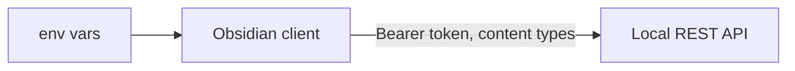
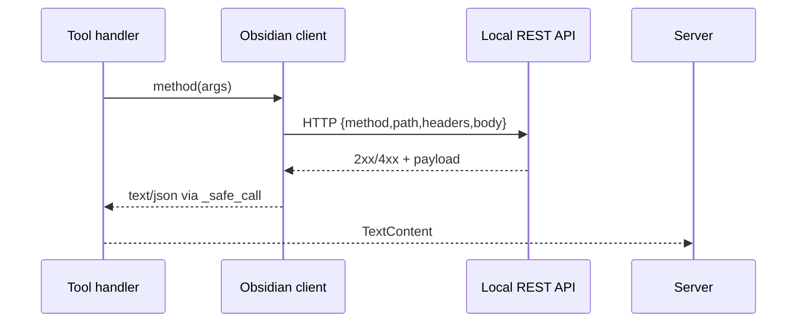
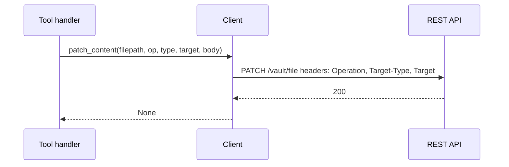

# API Integration

This document explains how the MCP Obsidian server talks to the Obsidian Local REST API, which headers and content types are used, and which endpoints each tool hits. It links to concrete client methods and server handlers.

See also [doc/overview.md](doc/overview.md), [doc/architecture.md](doc/architecture.md), [doc/tools.md](doc/tools.md), [openapi.yaml](openapi.yaml).

## Base URL, Auth, Timeouts

- Base URL: built from `OBSIDIAN_PROTOCOL` (defaults to https), `OBSIDIAN_HOST` (default 127.0.0.1), `OBSIDIAN_PORT` (default 27124) in [Obsidian.__init__()](src/mcp_obsidian/obsidian.py:7) and [Obsidian.get_base_url()](src/mcp_obsidian/obsidian.py:27).
- Authorization: `Authorization: Bearer <OBSIDIAN_API_KEY>` from [Obsidian._get_headers()](src/mcp_obsidian/obsidian.py:30).
- Timeouts: connect/read `(3, 6)` seconds in [Obsidian.__init__()](src/mcp_obsidian/obsidian.py:25).
- Error normalization: HTTP and request exceptions wrapped by [Obsidian._safe_call()](src/mcp_obsidian/obsidian.py:36).

## Endpoint Map by Client Method

Read operations:
- Vault root listing → [Obsidian.list_files_in_vault()](src/mcp_obsidian/obsidian.py:47) → GET `/vault/` (see [openapi.yaml](openapi.yaml)).
- Directory listing → [Obsidian.list_files_in_dir()](src/mcp_obsidian/obsidian.py:59) → GET `/vault/{dir}/`.
- File contents → [Obsidian.get_file_contents()](src/mcp_obsidian/obsidian.py:70) → GET `/vault/{filepath}`.

Search operations:
- Simple text search with context → [Obsidian.search()](src/mcp_obsidian/obsidian.py:102) → POST `/search/simple/` with query params `query`, `contextLength`.
- JsonLogic structured search → [Obsidian.search_json()](src/mcp_obsidian/obsidian.py:183) → POST `/search/` with `Content-Type: application/vnd.olrapi.jsonlogic+json`.
- Dataview DQL recent changes → [Obsidian.get_recent_changes()](src/mcp_obsidian/obsidian.py:253) → POST `/search/` with `Content-Type: application/vnd.olrapi.dataview.dql+txt`.

Write operations:
- Append markdown → [Obsidian.append_content()](src/mcp_obsidian/obsidian.py:116) → POST `/vault/{filepath}` `Content-Type: text/markdown`.
- Patch relative to target → [Obsidian.patch_content()](src/mcp_obsidian/obsidian.py:132) → PATCH `/vault/{filepath}` with headers:
  - `Operation: append|prepend|replace`
  - `Target-Type: heading|block|frontmatter`
  - `Target: urlencoded target` (set via `urllib.parse.quote` in client)
  - Body is markdown (`text/markdown`).
- Create/replace content → [Obsidian.put_content()](src/mcp_obsidian/obsidian.py:149) → PUT `/vault/{filepath}` `Content-Type: text/markdown`.
- Delete file/dir → [Obsidian.delete_file()](src/mcp_obsidian/obsidian.py:165) → DELETE `/vault/{filepath}`.

Periodic notes:
- Current period note → [Obsidian.get_periodic_note()](src/mcp_obsidian/obsidian.py:197) → GET `/periodic/{period}/` with optional `Accept: application/vnd.olrapi.note+json`.
- Recent periodic notes → [Obsidian.get_recent_periodic_notes()](src/mcp_obsidian/obsidian.py:222) → GET `/periodic/{period}/recent` with params `limit`, `includeContent` (this route may not be listed in [openapi.yaml](openapi.yaml) but is supported by the plugin).

## Tool-to-Endpoint Cross Reference

- obsidian_list_files_in_vault → [ListFilesInVaultToolHandler.run_tool()](src/mcp_obsidian/tools.py:46) → [list_files_in_vault()](src/mcp_obsidian/obsidian.py:47) → GET `/vault/`.
- obsidian_list_files_in_dir → [ListFilesInDirToolHandler.run_tool()](src/mcp_obsidian/tools.py:78) → [list_files_in_dir()](src/mcp_obsidian/obsidian.py:59) → GET `/vault/{dir}/`.
- obsidian_get_file_contents → [GetFileContentsToolHandler.run_tool()](src/mcp_obsidian/tools.py:115) → [get_file_contents()](src/mcp_obsidian/obsidian.py:70) → GET `/vault/{filepath}`.
- obsidian_simple_search → [SearchToolHandler.run_tool()](src/mcp_obsidian/tools.py:156) → [search()](src/mcp_obsidian/obsidian.py:102) → POST `/search/simple/`.
- obsidian_complex_search → [ComplexSearchToolHandler.run_tool()](src/mcp_obsidian/tools.py:423) → [search_json()](src/mcp_obsidian/obsidian.py:183) → POST `/search/`.
- obsidian_append_content → [AppendContentToolHandler.run_tool()](src/mcp_obsidian/tools.py:217) → [append_content()](src/mcp_obsidian/obsidian.py:116) → POST `/vault/{filepath}`.
- obsidian_patch_content → [PatchContentToolHandler.run_tool()](src/mcp_obsidian/tools.py:270) → [patch_content()](src/mcp_obsidian/obsidian.py:132) → PATCH `/vault/{filepath}`.
- obsidian_put_content → [PutContentToolHandler.run_tool()](src/mcp_obsidian/tools.py:315) → [put_content()](src/mcp_obsidian/obsidian.py:149) → PUT `/vault/{filepath}`.
- obsidian_delete_file → [DeleteFileToolHandler.run_tool()](src/mcp_obsidian/tools.py:356) → [delete_file()](src/mcp_obsidian/obsidian.py:165) → DELETE `/vault/{filepath}`.
- obsidian_batch_get_file_contents → [BatchGetFileContentsToolHandler.run_tool()](src/mcp_obsidian/tools.py:462) → [get_batch_file_contents()](src/mcp_obsidian/obsidian.py:81).
- obsidian_get_periodic_note → [PeriodicNotesToolHandler.run_tool()](src/mcp_obsidian/tools.py:503) → [get_periodic_note()](src/mcp_obsidian/obsidian.py:197) → GET `/periodic/{period}/`.
- obsidian_get_recent_periodic_notes → [RecentPeriodicNotesToolHandler.run_tool()](src/mcp_obsidian/tools.py:560) → [get_recent_periodic_notes()](src/mcp_obsidian/obsidian.py:222) → GET `/periodic/{period}/recent`.
- obsidian_get_recent_changes → [RecentChangesToolHandler.run_tool()](src/mcp_obsidian/tools.py:615) → [get_recent_changes()](src/mcp_obsidian/obsidian.py:253) → POST `/search/` with DQL.

## Headers and Content Types

- Authorization: `Authorization: Bearer <token>` from [Obsidian._get_headers()](src/mcp_obsidian/obsidian.py:30).
- Markdown write bodies: `Content-Type: text/markdown` in [append_content()](src/mcp_obsidian/obsidian.py:116), [put_content()](src/mcp_obsidian/obsidian.py:149), [patch_content()](src/mcp_obsidian/obsidian.py:132).
- Search formats:
  - Simple search uses query params in [search()](src/mcp_obsidian/obsidian.py:102).
  - JsonLogic: `application/vnd.olrapi.jsonlogic+json` in [search_json()](src/mcp_obsidian/obsidian.py:183).
  - Dataview DQL: `application/vnd.olrapi.dataview.dql+txt` in [get_recent_changes()](src/mcp_obsidian/obsidian.py:276).
- Metadata fetch for periodic notes: `Accept: application/vnd.olrapi.note+json` in [get_periodic_note()](src/mcp_obsidian/obsidian.py:213).

## Patch Operation Example

Example headers computed by the client:
- `Operation: append|prepend|replace`
- `Target-Type: heading|block|frontmatter`
- `Target: urlencoded identifier` (handled in [patch_content()](src/mcp_obsidian/obsidian.py:132))

## Error Model

- API HTTP errors (with JSON payload containing `errorCode`, `message`) are surfaced as rich messages by [Obsidian._safe_call()](src/mcp_obsidian/obsidian.py:36).
- Request exceptions (timeouts, network) are standardized to `Request failed: <reason>`.
- Server dispatch wraps any handler exception into a `RuntimeError` in [call_tool()](src/mcp_obsidian/server.py:76).

## OpenAPI Reference

The bundled [openapi.yaml](openapi.yaml) mirrors the plugin API including:
- Vault files and directories: `/vault/`, `/vault/{path}/`, `/vault/{filename}` blocks.
- Search: `/search/simple/` and `/search/`.
- Active file and periodic notes: `/active/`, `/periodic/{period}/` and date-indexed variants.

Where endpoints are not explicitly present (like `/periodic/{period}/recent`), the client method documents expected behavior and parameters.