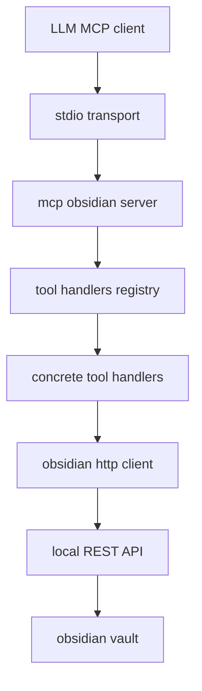
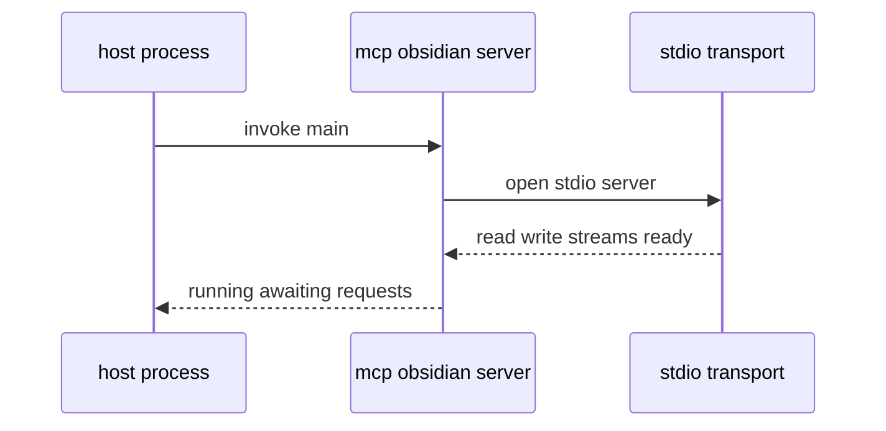
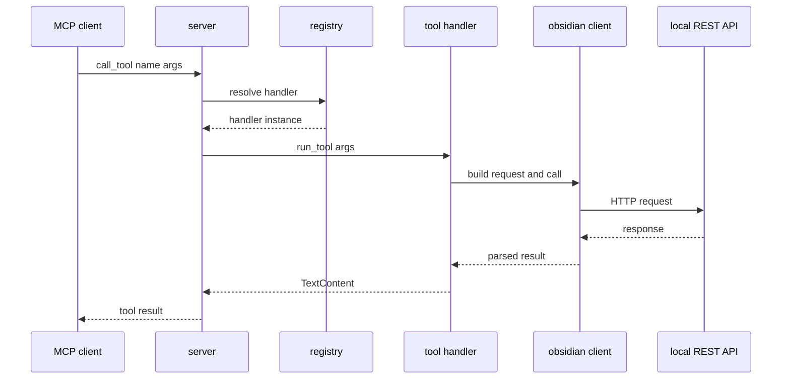
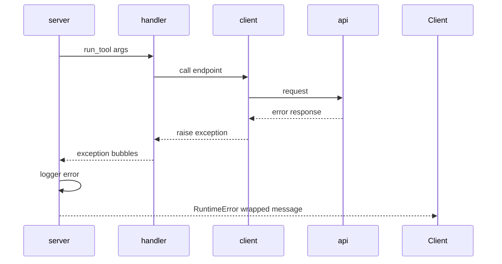
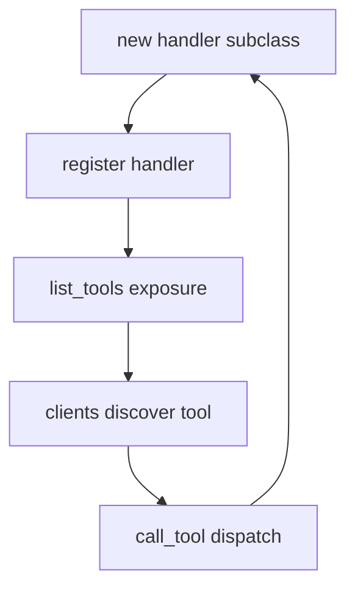

# Architecture

This document explains how the MCP Obsidian server is structured, how requests flow through the system, and how to extend it safely. It links directly to the key constructs in the codebase for quick navigation.

See also [doc/overview.md](doc/overview.md), [doc/tools.md](doc/tools.md), [doc/api-integration.md](doc/api-integration.md), [doc/configuration.md](doc/configuration.md), [doc/development.md](doc/development.md).

## Component Map

- Server: initialization and runtime loop via [main()](src/mcp_obsidian/server.py:83), tool list provider [list_tools()](src/mcp_obsidian/server.py:59), dispatcher [call_tool()](src/mcp_obsidian/server.py:65).
- Registry: in-memory mapping [tool_handlers](src/mcp_obsidian/server.py:32) populated by [add_tool_handler()](src/mcp_obsidian/server.py:33); lookup via [get_tool_handler()](src/mcp_obsidian/server.py:38).
- Tool handlers: subclasses of [ToolHandler](src/mcp_obsidian/tools.py:21) each implementing [get_tool_description()](src/mcp_obsidian/tools.py:25) and [run_tool()](src/mcp_obsidian/tools.py:28).
- HTTP client: the Obsidian adapter [Obsidian](src/mcp_obsidian/obsidian.py:6) offering methods like [get_base_url()](src/mcp_obsidian/obsidian.py:27), [_safe_call()](src/mcp_obsidian/obsidian.py:36), and endpoint wrappers.

## Startup and Initialization

1. Load env and validate key: [load_dotenv](src/mcp_obsidian/server.py:16) then `OBSIDIAN_API_KEY` read at [server api_key](src/mcp_obsidian/server.py:26); absence raises `ValueError`.
2. Create MCP app: [Server](src/mcp_obsidian/server.py:30) with name mcp-obsidian.
3. Register all tools by instantiating handlers and calling [add_tool_handler()](src/mcp_obsidian/server.py:33); see the registration block [44..56](src/mcp_obsidian/server.py:44).
4. Launch stdio server inside [main()](src/mcp_obsidian/server.py:83), using MCP stdio transport.

## Request Handling Flow

- Tool listing: [list_tools()](src/mcp_obsidian/server.py:59) returns the collected `Tool` descriptions from the registry.
- Tool execution: [call_tool()](src/mcp_obsidian/server.py:65) validates arguments, resolves the handler via [get_tool_handler()](src/mcp_obsidian/server.py:38), then calls the concrete handler [run_tool()](src/mcp_obsidian/tools.py:28).

## Core Modules and Contracts

- Server runtime
  - App instance: [Server](src/mcp_obsidian/server.py:30)
  - List tools entrypoint: [list_tools()](src/mcp_obsidian/server.py:59)
  - Dispatch entrypoint: [call_tool()](src/mcp_obsidian/server.py:65)
  - Event loop bootstrap: [main()](src/mcp_obsidian/server.py:83)

- Registry
  - Map: [tool_handlers](src/mcp_obsidian/server.py:32)
  - Registration: [add_tool_handler()](src/mcp_obsidian/server.py:33)
  - Lookup: [get_tool_handler()](src/mcp_obsidian/server.py:38)

- Tool handler interface
  - Base class: [ToolHandler](src/mcp_obsidian/tools.py:21)
  - Describe tool: [get_tool_description()](src/mcp_obsidian/tools.py:25)
  - Execute: [run_tool()](src/mcp_obsidian/tools.py:28)

- Obsidian client
  - Construction and defaults: [Obsidian.__init__()](src/mcp_obsidian/obsidian.py:7)
  - Base URL: [get_base_url()](src/mcp_obsidian/obsidian.py:27)
  - Error wrapping: [_safe_call()](src/mcp_obsidian/obsidian.py:36)

## Tool Handler Family

Handlers are defined in [src/mcp_obsidian/tools.py](src/mcp_obsidian/tools.py) and registered in [server](src/mcp_obsidian/server.py:44). Representative examples:

- Vault listing: [ListFilesInVaultToolHandler](src/mcp_obsidian/tools.py:31) and [ListFilesInDirToolHandler](src/mcp_obsidian/tools.py:58)
- Content access: [GetFileContentsToolHandler](src/mcp_obsidian/tools.py:94), [BatchGetFileContentsToolHandler](src/mcp_obsidian/tools.py:437)
- Search: [SearchToolHandler](src/mcp_obsidian/tools.py:130), [ComplexSearchToolHandler](src/mcp_obsidian/tools.py:373)
- Mutation: [AppendContentToolHandler](src/mcp_obsidian/tools.py:192), [PatchContentToolHandler](src/mcp_obsidian/tools.py:231), [PutContentToolHandler](src/mcp_obsidian/tools.py:290), [DeleteFileToolHandler](src/mcp_obsidian/tools.py:330)
- Periodic notes and activity: [PeriodicNotesToolHandler](src/mcp_obsidian/tools.py:476), [RecentPeriodicNotesToolHandler](src/mcp_obsidian/tools.py:527), [RecentChangesToolHandler](src/mcp_obsidian/tools.py:587)

Each handler:
- Describes its schema via [get_tool_description()](src/mcp_obsidian/tools.py:25) so clients can validate input.
- Implements [run_tool()](src/mcp_obsidian/tools.py:28) to call the [Obsidian](src/mcp_obsidian/obsidian.py:6) client and return `TextContent`.

## HTTP Client Behavior

The [Obsidian](src/mcp_obsidian/obsidian.py:6) client:
- Builds base URL from env via [Obsidian.__init__()](src/mcp_obsidian/obsidian.py:7) and [get_base_url()](src/mcp_obsidian/obsidian.py:27).
- Adds `Authorization Bearer` header in [_get_headers()](src/mcp_obsidian/obsidian.py:30).
- Wraps all calls with [_safe_call()](src/mcp_obsidian/obsidian.py:36) to normalize errors from `requests`.

Key operations:
- Read: [list_files_in_vault()](src/mcp_obsidian/obsidian.py:47), [list_files_in_dir()](src/mcp_obsidian/obsidian.py:59), [get_file_contents()](src/mcp_obsidian/obsidian.py:70), [get_batch_file_contents()](src/mcp_obsidian/obsidian.py:81)
- Search: [search()](src/mcp_obsidian/obsidian.py:102), [search_json()](src/mcp_obsidian/obsidian.py:183)
- Write: [append_content()](src/mcp_obsidian/obsidian.py:116), [patch_content()](src/mcp_obsidian/obsidian.py:132), [put_content()](src/mcp_obsidian/obsidian.py:149), [delete_file()](src/mcp_obsidian/obsidian.py:165)
- Periodic notes: [get_periodic_note()](src/mcp_obsidian/obsidian.py:197), [get_recent_periodic_notes()](src/mcp_obsidian/obsidian.py:222)
- Activity: [get_recent_changes()](src/mcp_obsidian/obsidian.py:253)

## Error Handling

- Server dispatch guard: [call_tool()](src/mcp_obsidian/server.py:65) catches exceptions, logs via [logger.error](src/mcp_obsidian/server.py:79), rethrows `RuntimeError` at [raise RuntimeError](src/mcp_obsidian/server.py:80).
- Client error normalization: [_safe_call()](src/mcp_obsidian/obsidian.py:36) maps HTTP error payloads into consistent messages.
- Input validation in handlers: e.g., presence checks in [SearchToolHandler.run_tool()](src/mcp_obsidian/tools.py:156) and others.

## Configuration and Defaults

- Required key at server startup: [OBSIDIAN_API_KEY](src/mcp_obsidian/server.py:26); tools module also validates key early at [api_key check](src/mcp_obsidian/tools.py:15).
- Host defaults: [obsidian host](src/mcp_obsidian/tools.py:13) and [constructor defaults](src/mcp_obsidian/obsidian.py:7).
- Protocol selection: [OBSIDIAN_PROTOCOL](src/mcp_obsidian/obsidian.py:10) with https default; http supported.
- SSL verification: `verify_ssl False` in [Obsidian.__init__()](src/mcp_obsidian/obsidian.py:7) to tolerate self signed local certs.

See deployment details in [README.md](README.md) and API surface in [openapi.yaml](openapi.yaml).

## Extensibility Guide

To add a new tool:
1. Create a handler class deriving from [ToolHandler](src/mcp_obsidian/tools.py:21) and implement [get_tool_description()](src/mcp_obsidian/tools.py:25) and [run_tool()](src/mcp_obsidian/tools.py:28).
2. Use the [Obsidian](src/mcp_obsidian/obsidian.py:6) client or add a new method there if you need an uncovered endpoint.
3. Register the handler in the server using [add_tool_handler()](src/mcp_obsidian/server.py:33).
4. The new tool will appear in [list_tools()](src/mcp_obsidian/server.py:59) automatically.

## Security and Operational Notes

- Scope actions to vault paths; do not accept absolute filesystem paths.
- Use https when the plugin provides certs; http only for trusted local setups.
- Protect the API key; it is read from env in [server](src/mcp_obsidian/server.py:26) and [tools](src/mcp_obsidian/tools.py:12).
- Keep timeouts reasonable; defaults in [Obsidian.__init__()](src/mcp_obsidian/obsidian.py:7) use short connect and read windows.

## Known Constraints

- Handlers are synchronous at the Python level; heavy operations can block the event loop around [call_tool()](src/mcp_obsidian/server.py:65). Consider offloading if you add expensive tasks.
- Error messages are normalized but not categorized; augment [_safe_call()](src/mcp_obsidian/obsidian.py:36) if you need richer error types.
