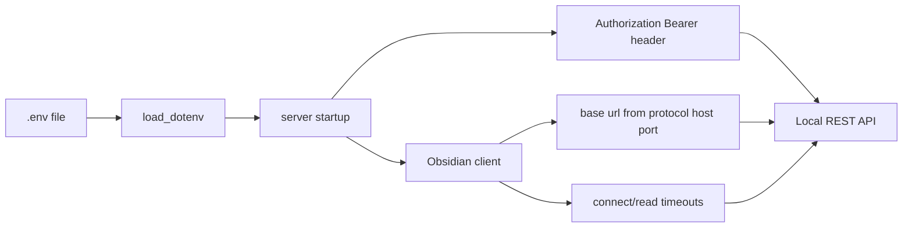

# Configuration

This document details environment setup and runtime configuration for the MCP Obsidian server, including required variables and wiring to the Obsidian Local REST API.

See also [doc/overview.md](doc/overview.md), [doc/architecture.md](doc/architecture.md), [doc/tools.md](doc/tools.md), [doc/api-integration.md](doc/api-integration.md), [README.md](README.md).

## Environment Variables

All environment variables are read at runtime using [get_obsidian_config()](src/mcp_obsidian/config.py:13), ensuring values set in your MCP client configuration are properly respected.

- **Required**: `OBSIDIAN_API_KEY` - Your Obsidian Local REST API key. Absence raises an error at startup in [server.py](src/mcp_obsidian/server.py:23).
- **Optional**: `OBSIDIAN_HOST` - Default: `127.0.0.1`. The hostname or IP where Obsidian is running.
- **Optional**: `OBSIDIAN_PORT` - Default: `27124`. The port where the Obsidian Local REST API is listening.
- **Optional**: `OBSIDIAN_PROTOCOL` - Default: `https`. Use `http` or `https`. Invalid values default to `https`.
- **Optional**: `OBSIDIAN_VERIFY_SSL` - Default: `false`. Set to `true` to enable SSL certificate verification (disabled by default for self-signed local certs).

**Important**: Environment variables are evaluated when each tool is called, not at module import time. This ensures that configuration passed to the MCP server (e.g., through Claude Desktop config) is properly used.

`.env` files are supported via [load_dotenv](src/mcp_obsidian/server.py:16). Example:

```env
OBSIDIAN_API_KEY=your_api_key_here
OBSIDIAN_HOST=127.0.0.1
OBSIDIAN_PORT=27124
OBSIDIAN_PROTOCOL=https
```

## Launch Commands

Install dependencies using `uv`:

```bash
uv sync
```

Run the server (script entry point is defined at [mcp-obsidian](pyproject.toml:25) -> [main()](src/mcp_obsidian/__init__.py:4)):

```bash
uvx mcp-obsidian
```

On first request, the server will advertise tools via [list_tools()](src/mcp_obsidian/server.py:59) and dispatch via [call_tool()](src/mcp_obsidian/server.py:65).

## Claude Desktop Configuration

You can configure Claude Desktop to launch the server. Example for published servers (see [README.md](README.md)):

```json
{
  "mcpServers": {
    "mcp-obsidian": {
      "command": "uvx",
      "args": ["mcp-obsidian"],
      "env": {
        "OBSIDIAN_API_KEY": "<YOUR_OBSIDIAN_API_KEY>",
        "OBSIDIAN_HOST": "127.0.0.1",
        "OBSIDIAN_PORT": "27124"
      }
    }
  }
}
```

For development using a local checkout:

```json
{
  "mcpServers": {
    "mcp-obsidian": {
      "command": "uv",
      "args": ["--directory", "<path_to_repo>/mcp-obsidian", "run", "mcp-obsidian"],
      "env": {
        "OBSIDIAN_API_KEY": "<YOUR_OBSIDIAN_API_KEY>",
        "OBSIDIAN_HOST": "127.0.0.1",
        "OBSIDIAN_PORT": "27124"
        }
    }
  }
}
```

## Configuration Flow



## Verifying Configuration

When the server starts, it logs the effective configuration (without exposing the API key):

```
INFO:mcp-obsidian:Obsidian API configured: https://127.0.0.1:27124
```

This log message confirms the protocol, host, and port that will be used for API calls.

## Troubleshooting

- **API Key Missing**: If `OBSIDIAN_API_KEY` is not set, startup fails with a clear error message showing the working directory.
- **Wrong Host/Port**: Check the startup log to verify the effective base URL. It should match your Obsidian plugin settings.
- **Connection Refused**: Ensure the Obsidian Local REST API plugin is running and the port matches.
- **SSL Errors**: If using `https` with self-signed certificates, ensure `OBSIDIAN_VERIFY_SSL` is set to `false` (the default).
- **Environment Not Respected**: Prior to version 0.2.2, environment variables were captured at import time. Upgrade to the latest version where config is read at runtime.

## Debugging

Use the MCP Inspector to test the server with different configurations:

```bash
OBSIDIAN_HOST=192.168.1.100 OBSIDIAN_PORT=27124 npx @modelcontextprotocol/inspector uv --directory /path/to/mcp-obsidian run mcp-obsidian
```

Check the startup log for the effective base URL, then try calling a tool to verify connectivity.