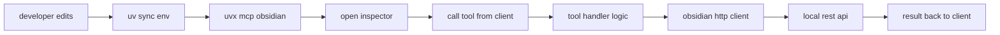

# Development

This guide covers local setup, running, debugging, and contributing conventions for the MCP Obsidian server.

See also [doc/overview.md](doc/overview.md), [doc/architecture.md](doc/architecture.md), [doc/tools.md](doc/tools.md), [doc/api-integration.md](doc/api-integration.md), [doc/configuration.md](doc/configuration.md).

## Requirements

- Python 3.11 or newer
- uv installed for environment and runner
- Node and npx for MCP Inspector

## Install Dependencies

Use uv to sync the project environment:

```bash
uv sync
```

Install dev tools like pyright:

```bash
uv sync --group dev
```

## Running the Server

The console entry point `mcp-obsidian` is mapped in [pyproject.toml](pyproject.toml:25) to [mcp_obsidian.__init__.main()](src/mcp_obsidian/__init__.py:4).

- With a published install:

```bash
uvx mcp-obsidian
```

- From a local checkout:

```bash
uv --directory /path/to/mcp-obsidian run mcp-obsidian
```

On startup the server validates `OBSIDIAN_API_KEY` at [server api_key](src/mcp_obsidian/server.py:26) and in [tools api_key](src/mcp_obsidian/tools.py:15).

## Debugging with MCP Inspector

This project runs over stdio. The recommended debugger is MCP Inspector.

```bash
npx @modelcontextprotocol/inspector uv --directory /path/to/mcp-obsidian run mcp-obsidian
```

The inspector prints a local URL to open in your browser.

Optional logs on macOS:

```bash
tail -n 20 -f ~/Library/Logs/Claude/mcp-server-mcp-obsidian.log
```

## Type Checking

If you installed the dev group:

```bash
pyright
```

## Architecture Pointers

- Entry lifecycle: [main()](src/mcp_obsidian/server.py:83) opens stdio transport and calls [app.run](src/mcp_obsidian/server.py:88).
- Tool discovery: [list_tools()](src/mcp_obsidian/server.py:59) collects tool specs from the registry.
- Dispatch: [call_tool()](src/mcp_obsidian/server.py:65) resolves handler and returns `TextContent`.
- Handler contract: [ToolHandler](src/mcp_obsidian/tools.py:21) with [get_tool_description()](src/mcp_obsidian/tools.py:25) and [run_tool()](src/mcp_obsidian/tools.py:28).
- REST client: [Obsidian](src/mcp_obsidian/obsidian.py:6) builds base URL in [get_base_url()](src/mcp_obsidian/obsidian.py:27) and wraps calls via [_safe_call()](src/mcp_obsidian/obsidian.py:36).

## Add a New Tool

1. Create a handler subclass of [ToolHandler](src/mcp_obsidian/tools.py:21).
2. Implement [get_tool_description()](src/mcp_obsidian/tools.py:25) with an input schema and [run_tool()](src/mcp_obsidian/tools.py:28).
3. Add an HTTP method in [obsidian client](src/mcp_obsidian/obsidian.py:6) if needed.
4. Register the handler using [add_tool_handler()](src/mcp_obsidian/server.py:33).
5. Verify the tool is listed via [list_tools()](src/mcp_obsidian/server.py:59) and callable through Inspector.

## Development Workflow



## Contribution Notes

- Keep handler execution lightweight; network I O already dominates latency.
- Validate inputs defensively inside [run_tool()](src/mcp_obsidian/tools.py:28).
- Prefer adding new client methods to [obsidian client](src/mcp_obsidian/obsidian.py:6) rather than issuing raw requests in handlers.
- Maintain consistent error messages by letting [_safe_call()](src/mcp_obsidian/obsidian.py:36) format HTTP and transport errors.
