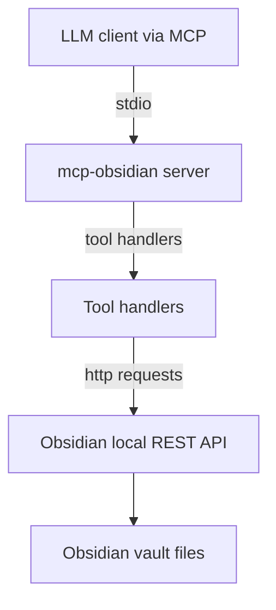
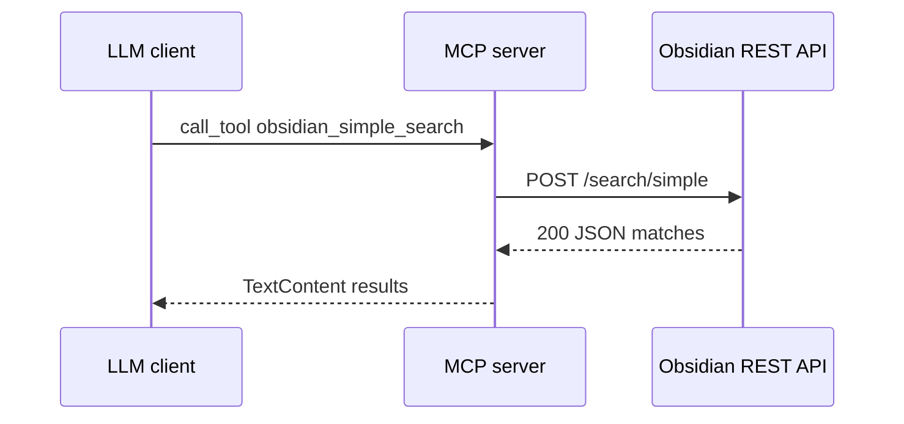
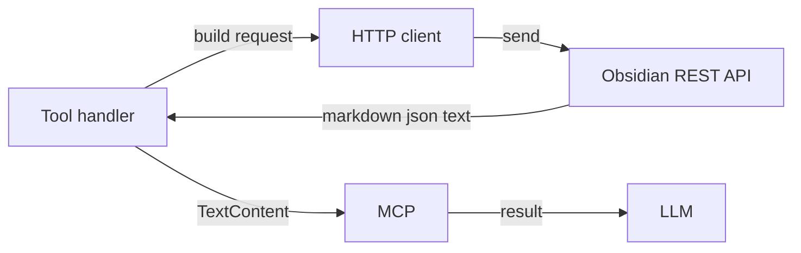

# MCP Obsidian Server — Overview

This project provides a Model Context Protocol server that exposes tool calls to read, search, and modify an Obsidian vault by talking to the Obsidian Local REST API community plugin.

See also [doc/architecture.md](doc/architecture.md), [doc/tools.md](doc/tools.md), [doc/api-integration.md](doc/api-integration.md), [doc/configuration.md](doc/configuration.md), [doc/development.md](doc/development.md).

## What It Does

- Provides an MCP server named mcp-obsidian that registers multiple tools for vault listing, content retrieval, text and structured search, content append or patch, file creation and deletion, and periodic notes utilities.
- Bridges LLM tools to Obsidian by converting MCP tool calls into HTTP requests against the local REST API, then returns results as MCP TextContent.

## Key Modules

- Server entry: [src/mcp_obsidian/server.py](src/mcp_obsidian/server.py) — defines [list_tools()](src/mcp_obsidian/server.py:59), [call_tool()](src/mcp_obsidian/server.py:64), and [main()](src/mcp_obsidian/server.py:83); registers handlers via [add_tool_handler()](src/mcp_obsidian/server.py:33).
- Tool handlers: [src/mcp_obsidian/tools.py](src/mcp_obsidian/tools.py) — abstract base [get_tool_description()](src/mcp_obsidian/tools.py:25) and [run_tool()](src/mcp_obsidian/tools.py:28); concrete handlers expose vault listing, search, patch, append, put, delete, batch reads, periodic notes, and recent changes.
- HTTP client for Obsidian: [src/mcp_obsidian/obsidian.py](src/mcp_obsidian/obsidian.py) — methods like [get_base_url()](src/mcp_obsidian/obsidian.py:27), [list_files_in_vault()](src/mcp_obsidian/obsidian.py:47), [get_file_contents()](src/mcp_obsidian/obsidian.py:70), [search()](src/mcp_obsidian/obsidian.py:102), [append_content()](src/mcp_obsidian/obsidian.py:116), [patch_content()](src/mcp_obsidian/obsidian.py:132), [put_content()](src/mcp_obsidian/obsidian.py:149), [delete_file()](src/mcp_obsidian/obsidian.py:165), [search_json()](src/mcp_obsidian/obsidian.py:183), [get_periodic_note()](src/mcp_obsidian/obsidian.py:197), [get_recent_periodic_notes()](src/mcp_obsidian/obsidian.py:222), [get_recent_changes()](src/mcp_obsidian/obsidian.py:253).

## Exposed Tools at a Glance

- obsidian_list_files_in_vault: list files in vault root.
- obsidian_list_files_in_dir: list directory contents.
- obsidian_get_file_contents: read file content.
- obsidian_simple_search: text search with context.
- obsidian_complex_search: JsonLogic or Dataview DQL based search.
- obsidian_append_content: append markdown to a note.
- obsidian_patch_content: insert relative to heading block or frontmatter.
- obsidian_put_content: create or replace note content.
- obsidian_delete_file: delete file or directory.
- obsidian_batch_get_file_contents: read multiple files concatenated.
- obsidian_get_periodic_note: fetch current periodic note by period.
- obsidian_get_recent_periodic_notes: list recent periodic notes.
- obsidian_get_recent_changes: recent modified files via DQL.

## System Context

## Request Sequence Example

## Data Flow

## Next Documents

- Deep dive architecture: [doc/architecture.md](doc/architecture.md)
- Tool catalog and inputs: [doc/tools.md](doc/tools.md)
- API integration details: [doc/api-integration.md](doc/api-integration.md)
- Configuration and environment: [doc/configuration.md](doc/configuration.md)
- Development and debugging: [doc/development.md](doc/development.md)